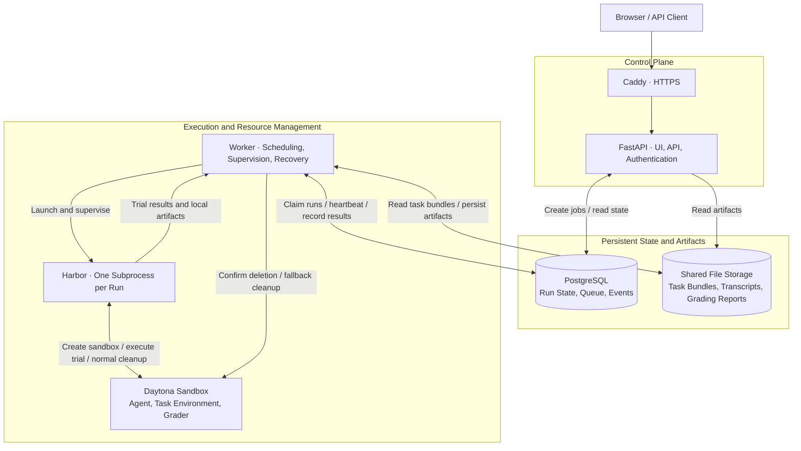

# Error Classification and Retry Policy

This document maps the code's error handling: how each failure is classified, whether it is retried, and why. It describes the implementation, not a claim that every path has been exercised in production.

## System architecture: control and execution



The API accepts requests without waiting for execution. PostgreSQL is both the system of record and the durable queue. Workers drive execution through Harbor, persist results, and confirm sandbox cleanup. Harbor runs the trial; Daytona provides the isolated compute environment. The current file store is a shared Docker volume, not an object storage service.

## How classification works

The platform combines structured Harbor output with events detected by the worker:

- Harbor's `result.json`: exception type, exception message, and reward.
- The grader's `report.json`: failed criteria, missing deliverables, and judge failures or skipped checks.
- Worker observations: process startup failure, shutdown, platform deadline, artifact persistence failure, or an expired heartbeat deadline.

Classification produces a stored `status`, an optional `error_kind`, an error message, a reward, and a decision about automatic retry. The UI outcome is derived from the stored fields using the same policy as the API and job summary. Logs explain the result; the platform does not use an LLM to infer the error category from log text.

## Complete status vocabulary

Run status is stored in `runs.status`. Job status is calculated from the latest (effective) try of each task attempt and the job's cancellation request; it is not a separate stored `jobs.status` column. Neither is the same as the derived evaluation `outcome`.

### Run statuses: all six values

| `runs.status` | Meaning | Terminal? |
| --- | --- | --- |
| `queued` | Waiting to be claimed. This includes retries waiting for backoff, previous sandbox cleanup, or a concurrency slot. | No |
| `running` | Claimed by a worker. Includes task preparation, Harbor execution, grading, and result persistence before finalization; it does not necessarily mean the agent is currently executing. | No |
| `completed` | Execution produced a scored task result. Zero and partial rewards are valid here; this status does not mean the task passed. | Yes |
| `error` | Infrastructure or grader failure. `error_kind` and `error_message` describe the cause. Retry eligibility depends on the specific failure. | Yes |
| `timed_out` | The agent exceeded its task time limit (`AgentTimeoutError`). Any available score is retained. Grader timeouts and platform deadlines are classified as `error` instead. | Yes |
| `cancelled` | The run was cancelled before execution, stopped after cancellation, or finalized through cancellation recovery. | Yes |

```text
queued -> running -> completed
                  -> error
                  -> timed_out
                  -> cancelled
queued -----------> cancelled
```

A terminal run does not return to `queued`: a retry creates a new row. Terminal status also does not confirm resource deletion. `sandbox_cleared_at` separately records whether sandbox cleanup has been confirmed.

### Job statuses: all five values

The following conditions match `queue.job_status()` in evaluation order. “Active” means a run is `queued` or `running`; counts use effective runs, excluding tries replaced by a retry.

| Job `status` | Exact condition | Meaning |
| --- | --- | --- |
| `finished` | No active effective runs, and no cancellation request. | Every effective run is terminal; some or all may have failed or timed out. This does not mean all tasks passed. |
| `cancelled` | No active effective runs, and a cancellation request exists. | The job has no work left in flight after cancellation. Earlier completed results remain unchanged. |
| `cancelling` | At least one active effective run, and a cancellation request exists. | Cancellation is still being processed. |
| `queued` | There is active work, no cancellation request, and every effective run is `queued`. | All current tries are waiting to be claimed. |
| `running` | There is active work, no cancellation request, and the effective runs are not all `queued`. | The job is in progress. This also covers a mixture of terminal and queued runs even when no individual run is currently `running`. |

Job status can change from `finished` back to `queued` or `running` when a manual retry adds new work. A fully stopped cancelled job can also be reopened by manual retry. Job status does not independently wait for `sandbox_cleared_at`; cleanup progress is reported separately.

### Status versus outcome

`outcome` is computed by `outcomes.run_outcome()` and is not another stored run state. Its complete vocabulary is:

| Derived `outcome` | Stored fields used |
| --- | --- |
| `queued` | `status=queued` |
| `running` | `status=running` |
| `passed` | `status=completed`, reward >= 1 |
| `partial` | `status=completed`, 0 < reward < 1 |
| `failed` | `status=completed`, reward <= 0; the implementation also treats a missing reward as zero for display |
| `timed_out` | `status=timed_out` |
| `infra_error` | `status=error`, with an error kind other than `verifier` or `judge_config` |
| `grader_error` | `status=error`, with `error_kind=verifier` or `judge_config` |
| `cancelled` | `status=cancelled` |

For example, a zero-reward task result is `status=completed, outcome=failed`. A sandbox creation failure is `status=error, error_kind=sandbox, outcome=infra_error`. `finished` and `cancelling` are job statuses only; `passed`, `partial`, `failed`, `infra_error`, and `grader_error` are outcomes, not run statuses.

## Classification and automatic retries

“Retry” below means eligible for the shared automatic retry policy described in the next section.

| Category / UI outcome | Stored status / error kind | Concrete condition | Automatic retry |
| --- | --- | --- | --- |
| Task failure: `failed` | `completed` / none | The grader produces a valid reward of `0`, without a higher-priority infrastructure or grading error. | No. A zero reward is a valid result. |
| Partial result or pass: `partial` / `passed` | `completed` / none | A valid reward between `0` and `1` is partial; a reward of at least `1` passes. | No. |
| Agent timeout: `timed_out` | `timed_out` / none | `AgentTimeoutError`: the agent exceeds its task time limit. Any existing score is retained. | No. |
| Task preparation failure: `infra_error` | `error` / `setup` | Loading the run context or materializing the task bundle on the worker fails. | Yes. |
| Sandbox failure: `infra_error` | `error` / `sandbox` | An exception whose type starts with `Daytona`, `EnvironmentStartTimeoutError`, or `AgentSetupTimeoutError`. | Yes. |
| Transient model API failure: `infra_error` | `error` / `model_api` | `ApiRateLimitError`, `ApiInternalServerError`, `ApiOverloadedError`, `ApiConnectionClosedError`, `ApiResponseStalledError`, or `UnknownApiError`. | Yes. |
| Model API configuration or usage problem: `infra_error` | `error` / `model_api` | `AgentAuthenticationError`, `ModelNotFoundError`, `ApiUsageLimitError`, or `ApiProviderResourceNotFoundError`. | No. Configuration, billing, or provider resource availability needs attention. |
| Harbor startup failure or missing result: `infra_error` | `error` / `harbor_crash` | The worker cannot start Harbor, or Harbor exits without a readable trial result. | Yes. |
| Harbor hang: `infra_error` | `error` / `harbor_hang` | Harbor exceeds the platform deadline, derived from the environment, agent, and verifier time limits plus a margin. | Yes. |
| Other Harbor failure: `infra_error` | `error` / `harbor_error` | Harbor reports an exception that does not match a known category, and there is no reward. | Yes. |
| Judge API failure: `infra_error` | `error` / `judge_api` | Judge-enabled grading leaves judged criteria undecided with a note starting with `judge error`. This overrides an otherwise completed or timed-out result. | Yes. The scalar reward is cleared because the grading is incomplete. |
| Artifact persistence failure: `infra_error` | `error` / `sync_failed` | Saving artifacts fails after a result classified as `completed`. | Yes. The whole run is retried, not just the artifact transfer. |
| Worker lost: `infra_error` | `error` / `worker_lost` | A run is still `running` after its worker heartbeat deadline expires. | Yes, unless the job has requested cancellation. |
| Worker shutdown: `infra_error` | `error` / `worker_shutdown` | An orderly worker shutdown interrupts Harbor during a run. | Yes, unless the job has requested cancellation. |
| Grader failure: `grader_error` | `error` / `verifier` | `RewardFileNotFoundError`, `RewardFileEmptyError`, `VerifierOutputParseError`, `AddTestsDirError`, `DownloadVerifierDirError`, `VerifierTimeoutError`, or a result with neither a Harbor exception nor a reward. | No. |
| Judge configuration failure: `grader_error` | `error` / `judge_config` | Judge-enabled grading leaves judged criteria undecided with a `skipped` note, interpreted as a missing judge API key. | No. The scalar reward is cleared. |
| User cancellation: `cancelled` | `cancelled` / none | The user cancels the job, or an expired run is recovered after cancellation was requested, or a run ends with any failure this table marks as retried after cancellation was requested (its worker hears of a cancel only at the next heartbeat). The failure is kept in the message. | No. |

Classification order matters. A reward does not override a recognized model API, sandbox, or verifier error. Conversely, an otherwise unclassified agent exception with a reward is treated as a scored task result, with its exception message retained.

## Complete `retryable=True` and `retryable=False` cases

`Outcome.retryable` is an in-memory boolean, defaulting to `False` in `models.py`. Harbor does not supply it, and it is not a persisted column in `runs`. The following tables enumerate the current code branches; the code remains the source of truth. Earlier classification branches take precedence over later fallbacks, and the overrides below can change the initial decision.

### Cases that set `retryable=True`

| Decision owner | Exact trigger | Resulting status / error kind |
| --- | --- | --- |
| Worker: task preparation | An exception while loading run context or materializing the task bundle. | `error / setup` |
| Worker: check before starting Harbor | The final heartbeat/ownership/cancellation check raises an exception or exceeds its timeout. Harbor is not started. | `error / setup` |
| Worker: process startup | `asyncio.create_subprocess_exec()` raises `OSError`. | `error / harbor_crash` |
| Classifier: worker shutdown | `stop_reason == StopReason.SHUTDOWN`. | `error / worker_shutdown` |
| Classifier: platform deadline | `stop_reason == StopReason.DEADLINE`. | `error / harbor_hang` |
| Classifier: missing result | `result is None`, after checking stop reasons. This includes a missing or unreadable-as-JSON trial result. | `error / harbor_crash` |
| Classifier: transient model API | `ApiRateLimitError`, `ApiInternalServerError`, `ApiOverloadedError`, `ApiConnectionClosedError`, `ApiResponseStalledError`, or `UnknownApiError`. | `error / model_api` |
| Classifier: sandbox | The exception name starts with `Daytona`, or is `EnvironmentStartTimeoutError` or `AgentSetupTimeoutError`. | `error / sandbox` |
| Classifier: fallback | An exception is present, no earlier exception category matches, and no reward is available. | `error / harbor_error` |
| Judge override | The initial result is `completed` or `timed_out`, judge is enabled, and a judged criterion (`kind: judge`) has `passed: null` with a note starting with `judge error`. | `error / judge_api`; scalar reward cleared |
| Worker: artifact persistence override | Artifact saving raises an exception and the classified status was `completed`. | `error / sync_failed` |

### Cases that set or retain `retryable=False`

| Decision owner | Exact trigger | Resulting status / error kind |
| --- | --- | --- |
| Model default | An `Outcome` is constructed without explicitly enabling retry. The cases below use this default unless stated otherwise. | Depends on the outcome |
| Classifier: cancellation | `stop_reason == StopReason.CANCELLED`. | `cancelled / none` |
| Worker: cancellation before startup | The final check reports cancellation before Harbor starts. No sandbox is created by this execution. | `cancelled / none` |
| Classifier: scored result | No Harbor exception and a reward exists, including zero, partial credit, and a full score. | `completed / none` |
| Classifier: unclassified exception with a score | An exception does not match any earlier category, but a reward exists. The exception message is retained. | `completed / none` |
| Classifier: no score | A result exists, but has neither an exception type nor a reward. | `error / verifier` |
| Classifier: agent timeout | `AgentTimeoutError`, with or without a reward. | `timed_out / none` |
| Classifier: model API configuration or usage failure | `AgentAuthenticationError`, `ModelNotFoundError`, `ApiUsageLimitError`, or `ApiProviderResourceNotFoundError`. | `error / model_api` |
| Classifier: grader failure | `RewardFileNotFoundError`, `RewardFileEmptyError`, `VerifierOutputParseError`, `AddTestsDirError`, `DownloadVerifierDirError`, or `VerifierTimeoutError`. | `error / verifier` |
| Judge override | The initial result is `completed` or `timed_out`, judge is enabled, and an undecided judged criterion has a note starting with `skipped`, with no `judge error` match taking precedence. | `error / judge_config`; scalar reward cleared |
| Queue: cancellation override | At `finish_run()`, the job has requested cancellation and the incoming outcome was retryable. `_cancelled_instead()` explicitly sets `retryable=False`. | `cancelled / none`; original failure retained in the message |

### Overrides, unchanged decisions, and special paths

- **Judge checks run after the base classification.** They only override `completed` or `timed_out` results. A judge API failure can therefore turn an initially non-retryable task result or timeout into a retryable error. Judge API failures take precedence over skipped-criterion configuration failures if both are present.
- **No recognized judge problem means no change.** Judge disabled, a missing/non-dictionary report, or criteria without the recognized undecided-note pattern do not independently change `retryable`.
- **Artifact sync does not override every failure.** If the outcome is already `error`, `timed_out`, or `cancelled`, a sync failure only appends an error message and preserves its existing retry decision. An existing retryable error stays retryable; a non-retryable error or timeout stays non-retryable.
- **Worker loss bypasses the boolean.** `reap_expired()` detects expired running records. Without a cancellation request, it writes `error / worker_lost` and calls `schedule_retry()` directly. With cancellation requested, it writes `cancelled` and does not schedule a retry.
- **Lost ownership is not `retryable=False`.** If the executing worker no longer owns the run, it does not finalize that run or schedule another execution. Recovery belongs to the worker that reaps the expired record.
- **Informational logging failures do not create retryable outcomes.** For example, failure to record the Harbor command logs a warning and execution continues.
- **Eligibility is not a guarantee of a retry.** The retry cap, cancellation, and an already-existing retry can prevent a new row from being inserted without changing the classifier's original boolean. Cleanup, backoff, and concurrency conditions control when a queued retry can start.
- **Manual retry is independent of this boolean.** A user can request a new try of a terminal run that was not automatically retryable, subject to the manual retry rules below.

## Shared automatic retry policy

1. **Bounded retries.** `MAX_INFRA_RETRIES` defaults to `2`: one initial execution plus at most two automatic retries.
2. **Exponential backoff.** `RETRY_BACKOFF_SEC` defaults to `15`. The delay is `base × 2^auto_retries`, giving minimum waits of 15 and 30 seconds with the defaults. Queue load, concurrency limits, and cleanup can delay execution further.
3. **New records.** Each retry creates a new run row linked to its predecessor through `retry_of`. The original failure, logs, and result remain available. The task attempt number stays the same; the retry number increases.
4. **Cleanup before execution.** A retry cannot start while another try of the same job/task/agent/attempt has started but lacks `sandbox_cleared_at`. The retry may already be queued while cleanup is pending.
5. **Cancellation and deduplication.** No automatic retry is created after the job requests cancellation or the retry budget is exhausted. In a cancelled job, a failure that would have been retried ends `cancelled` instead, since the cancel is why it is final; results and non-retried errors keep their category. The finishing worker and the reaper both lock the job row before deciding, so a concurrent cancel is either seen or waits. A uniqueness constraint prevents duplicate retry rows for the same retry number.

For example:

```text
Initial run fails
  -> retry 1 queued, eligible after at least 15 seconds
  -> starts only after the previous sandbox is confirmed cleared
  -> fails
  -> retry 2 queued, eligible after at least 30 seconds
  -> starts only after the previous sandbox is confirmed cleared
  -> fails
  -> no further automatic retry
```

The classifier sets retry eligibility. The queue owns retry creation, the retry budget, and backoff. The claim logic enforces cleanup and concurrency requirements.

## Manual retry

The current local implementation also supports a user-requested retry of a terminal task attempt:

- It can rerun a scored result, a timeout, an error, or a cancelled run.
- It creates a new record after the attempt's latest try and starts a fresh automatic retry budget.
- It still waits for prior sandbox cleanup before starting.
- If the latest try is an active manual retry, another request returns that existing run. An active initial or automatic try prevents creation of another retry.
- A job still being cancelled cannot be retried until its runs stop. Once they have stopped, a manual retry can clear the cancellation request and reopen the job.

These statements describe code present locally; they do not independently establish deployment or production verification of the manual retry feature.

## Stored diagnostics and UI behavior

| Field | Purpose |
| --- | --- |
| `status` | Execution state: `completed`, `timed_out`, `error`, or `cancelled`, in addition to active states. |
| `error_kind` | Specific system or grader failure category. |
| `error_message` | Harbor's exception type and message, or a platform-generated explanation. |
| `reward` | Scalar score, when available; judge failures invalidate it. Infrastructure errors are excluded from evaluation statistics even if a score remains stored. |
| `grade` | Failed and ungraded criterion IDs, missing deliverables, and grader report errors. |
| `log_tail` / `log_source` | Relevant diagnostic excerpt and its artifact path. |
| `artifact_prefix` | Location of persisted run artifacts. |

Log selection prefers grader output for verifier/judge failures, Harbor's `exception.txt` for sandbox/model failures and agent timeouts, and falls back to `harbor.log`. The UI shows the explanation and offers access to the corresponding full log when available.

Job summaries use the latest try of each task attempt. Completed runs and agent timeouts count toward pass rate and mean reward; a timeout without a score contributes zero. Infrastructure errors, grader errors, cancellation, and superseded tries do not count toward that denominator. Only the `passed` outcome (a completed run scoring at least `1`) counts as passing: a timeout counts toward the denominator and mean reward but never as a pass, whatever it scored, so the pass count matches the outcome counts.

## Current boundaries

- **Daytona errors are broadly retryable.** A permanently invalid resource request, such as requesting 64 CPUs when only 8 are allowed, is currently retried too.
- **Sync failure does not always change the category.** Only an originally `completed` result becomes `sync_failed`. An already timed-out, cancelled, or errored result keeps its category and retry decision; the sync failure is appended to its message.
- **Judge detection depends on report contents.** The checks recognize undecided judged criteria with specific note prefixes. They do not independently validate every possible missing or malformed judge response. Intentionally disabling the judge does not trigger these errors.
- **Classification is an explicit mapping.** Exception names not covered by the mapping follow the fallback behavior described above.

## Policy choices

Retries are for failures that say nothing about the task or the model: infrastructure errors are retried automatically, a capped number of times with exponential backoff; a zero reward, a timeout, or a broken grader is never retried automatically, since running it again would only repeat the result. Every retry is a new run linked to the one it replaces, so the original failure stays on record, and any finished run can be retried by hand.

The retry count, backoff intervals, exception mappings, non-retryable API errors, and the treatment of agent timeouts and grader failures are configurable or local choices; classification and observability come first, and the retry policy is driven by them.

## Code references

- [Status and error vocabulary](rollout/models.py)
- [Harbor result classification and diagnostic selection](rollout/runner.py)
- [Worker execution and artifact persistence](rollout/worker.py)
- [Retry scheduling, heartbeat recovery, and claim constraints](rollout/queue.py)
- [Shared UI outcomes and summary calculations](rollout/outcomes.py)
- [Configuration defaults](rollout/config.py)
